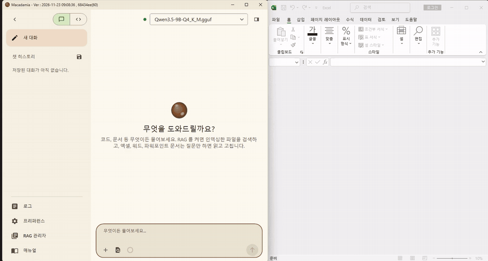
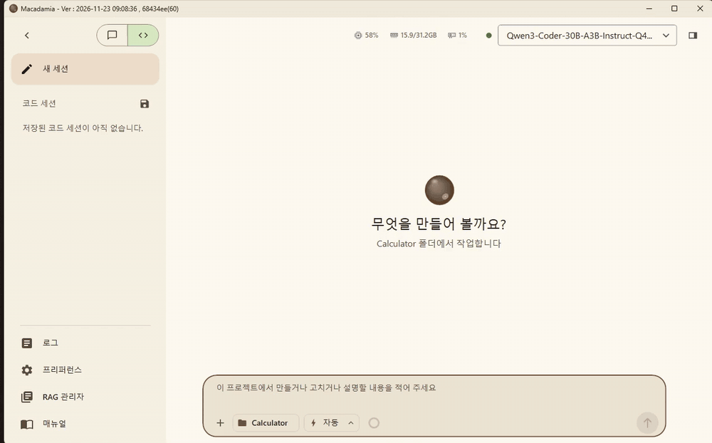

# Macadamia

인터넷 연결 없이 내 PC 에서 동작하는 **로컬 LLM 코드 대화 프로그램**입니다.
`gguf` 모델(llama.cpp)로 코드 생성, 분석, 디버깅을 하고, 내 소스 코드와 문서를 검색(RAG)해 답변에 활용합니다.

이 저장소는 **설치 파일 배포 전용**입니다. 소스 코드는 들어 있지 않으며, 설치 파일은 [Releases](https://github.com/jylee-akc/Macadamia-Release/releases/latest) 에 있습니다.

> Windows x64 · 완전 오프라인 동작 · 채팅 모드와 코드 모드

## 채팅 모드

질문하고 답을 받는 일반 대화입니다. 파일과 이미지를 첨부할 수 있고, 내 문서를 검색해 답하며, 열려 있는 Office 문서를 직접 읽고 고칩니다.

*Excel 문서를 만들고 합계를 구하는 장면 (1.5배속). [원본 화질 영상](media/chat.mp4)*

- **스트리밍 응답**: 답변을 바로 보여 주고 언제든 중지할 수 있습니다.
- **파일, 이미지 첨부**: 코드와 문서를 끌어다 놓아 질문합니다. 이미지를 읽는 모델이면 이미지도 분석합니다.
- **RAG 검색**: 내 소스 코드와 문서를 색인해 두면 에러 코드나 클래스 이름까지 찾아 답변에 씁니다.
- **Office 문서 작업**: "엑셀에 합계 넣어줘" 처럼 말하면 열려 있는 Excel, Word, PowerPoint, 한글 문서를 읽고 고칩니다. 문서를 바꾸기 전에는 승인을 묻습니다.

## 코드 모드

프로젝트 폴더를 고르면 그 안에서 파일을 읽고 고치고, 빌드하고, 실행해서 확인하는 코딩 에이전트입니다.

*계산기 프로그램을 만들고 빌드한 뒤 직접 띄워 확인하는 장면 (8배속, 실제 약 5분 40초, 30B 코딩 모델). [원본 화질 영상](media/code.mp4)*

- **파일 작업**: 프로젝트의 파일을 읽고, 검색하고, 고칩니다.
- **명령 실행**: PowerShell 명령으로 빌드, 테스트, git 작업을 합니다.
- **스스로 확인**: 고친 뒤 빌드하고, 만든 프로그램을 띄워 단추를 누르고 화면을 확인합니다.
- **권한 모드**: 수동 승인, 편집 자동 수락, 계획, 자동 중에서 맡길 범위를 고릅니다. 편집과 명령 전에 승인 카드로 묻습니다.
- **작업 패널**: 바꾼 파일, 실행한 명령, 진행 상황을 오른쪽 패널에서 봅니다.

결과는 모델에 크게 좌우됩니다. 프로그램을 통째로 만드는 작업은 코딩용 큰 모델(30B 급)을 권장합니다.

## 설치

### 필요한 것

| 항목 | 내용 |
| :--- | :--- |
| 운영체제 | Windows 10 / 11 (x64) |
| .NET | .NET Framework 4.8 |
| Python | 3.10 (RAG 검색을 쓸 때. 설치할 때 "Add python.exe to PATH" 선택) |
| GPU | NVIDIA GPU 권장 (없어도 CPU 로 동작) |
| 모델 | GGUF 모델 파일 (앱의 모델 검색 창에서 받거나 `models` 폴더에 넣음) |
| 라이선스 | PC 별로 발급하는 `license.dat` (배포 담당자에게 요청) |

### 순서

1. [최신 릴리스](https://github.com/jylee-akc/Macadamia-Release/releases/latest)에서 `Macadamia.msi` 와 모든 `cab*.cab` 파일을 **같은 폴더**에 받습니다. (`macadamia_update.json` 은 자동 업데이트용이라 받지 않아도 됩니다.)
2. 발급받은 `license.dat` 를 같은 폴더에 둡니다.
3. `Macadamia.msi` 를 실행해 설치합니다.
4. Macadamia 를 실행하고 환경설정에서 모델을 고릅니다.

릴리스에 자동으로 붙는 "Source code" 압축 파일에는 이 안내문만 들어 있습니다.

## 자동 업데이트

한 번 설치하면 새 버전이 올라올 때 앱이 알아서 알려 줍니다.

- 앱을 시작하고 30초 뒤, 그 뒤로는 4시간마다 새 버전을 확인합니다.
- 새 버전이 있으면 변경 내용과 함께 **지금 업데이트 / 나중에** 를 묻습니다.
- 지금 업데이트를 고르면 설치 파일을 받아 검증한 뒤 설치하고 앱을 다시 띄웁니다. 받다가 끊겨도 이어서 받습니다.
- 인터넷에 연결되어 있지 않으면 아무 일도 하지 않습니다. 앱은 그대로 쓸 수 있습니다.

자동 업데이트는 이 기능이 들어간 버전(커밋 수 60 이상)부터 인터넷으로 받을 수 있습니다. 그보다 이전 버전은 위 순서대로 한 번 직접 설치해 주세요.
